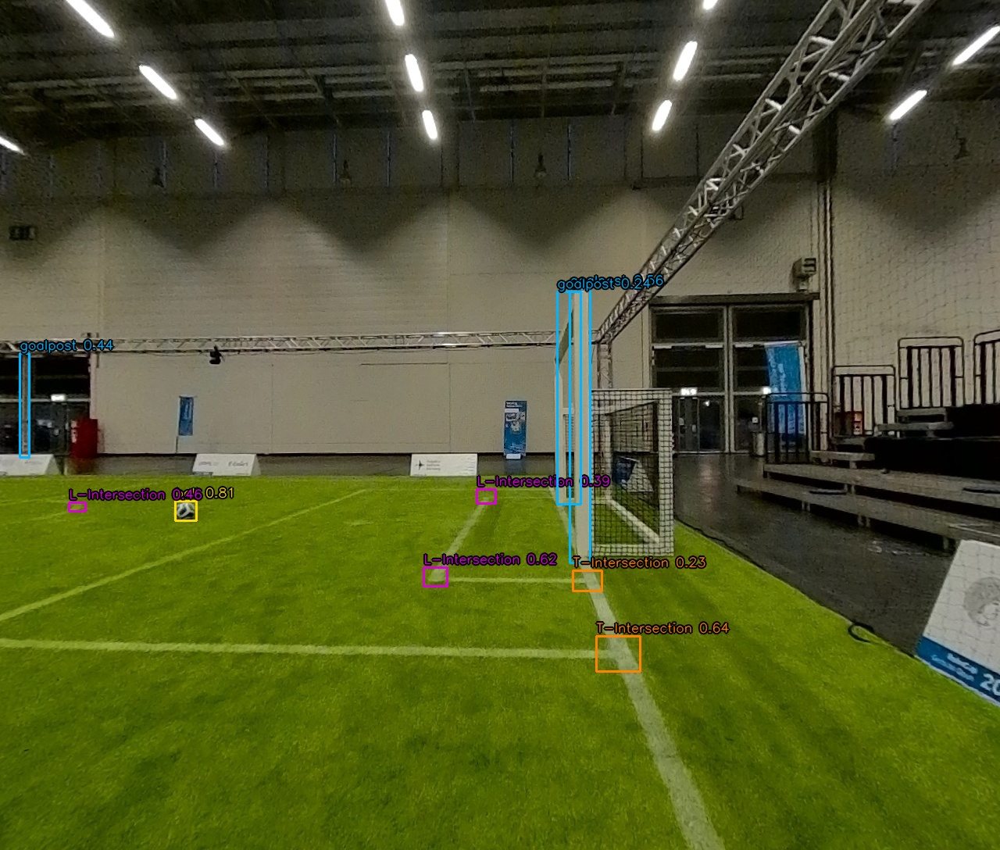

# NUbots ONNX model

The imported model is currently at `../../yolo.onnx` relative to this directory.
It matches `NUbots/module/vision/Yolo/data/yolo.onnx` in the sibling checkout.
SHA-256: `aa2de20c0143902dba8cc05acd10d366783cc38cbb3b6a1d56e89b9732f7525a`.

## Model contract

Embedded metadata identifies an Ultralytics YOLO11n detection model, opset 17.
Input `images` is float32 `[1, 3, 640, 640]`; output `output0` is float32
`[1, 10, 8400]`. NMS is not embedded.

The matching NUbots `module/vision/Yolo/src/Yolo.cpp` places BGR images at the
top-left of a black square of side `max(width, height)`, resizes to 640 x 640,
swaps BGR to RGB, and scales by 1/255 into NCHW format. Predictions contain
center x/y, width/height in input pixels, followed by six class scores.
Use the maximum class score directly, without an objectness multiplier.
Map coordinates back by multiplying by `max(width, height) / 640`.
This describes the checked runtime code; original training/export scripts
have not been located.

## Class mapping

`onnx::MakeDetection` in `vision/booster_vision/onnx/impl.cpp` converts model
IDs into the shared HTWK class IDs and labels when building `DetectionRes`.
Keep raw model IDs until NMS is complete.

| NUbots ID | Model label | HTWK ID | HTWK label / category |
| --- | --- | --- | --- |
| 0 | ball | 0 | Ball / ball |
| 1 | goalpost | 1 | Goalpost / goalpost |
| 2 | robot | 7 | Opponent / opponent |
| 3 | L-Intersection | 3 | LCross / lcross |
| 4 | T-Intersection | 4 | TCross / tcross |
| 5 | X-Intersection | 5 | XCross / xcross |

Mapping every robot to Opponent is the chosen integration policy. The model
does not distinguish teammates from opponents. It has no classes for Person,
PenaltyPoint, or BRMarker, so this profile produces none of those categories.
Invalid model IDs and unknown profiles are rejected. The Booster profile
preserves the existing nine-class ordering.

The conversion helper is implemented; ONNX loading, inference, and its call
to this helper are still pending. The NUbots runtime uses class-agnostic NMS;
the proposed per-class NMS for this integration would differ from that behavior.

## CPU image demo

From the HTWK-vision repository root, with `numpy`, `onnx`, and
`opencv-python-headless` installed in your Python environment:

```bash
python src/demo_nubots_onnx.py yolo.onnx \
  ../datasets/hslvision/images/test/4.jpg \
  --output-dir ../runs/nubots_onnx_cpu/4
```

The demo uses OpenCV DNN with the CPU target and the preprocessing above.
It saves `annotated.jpg`, `detections.json`, and the original output tensor as
`raw_output.npy`. Labels and IDs remain in the original model vocabulary.
Defaults are confidence 0.2, IoU 0.5, and per-class NMS; use
`--nms-mode class-agnostic` for the NUbots suppression grouping. The demo still
uses one global confidence threshold rather than NUbots' per-class thresholds.

Verified with OpenCV 4.14.0 on HSLVision `4.jpg` (1280 x 1088): output shape
`[1, 10, 8400]`, all values finite, 41 candidates above threshold, and 9 final
boxes (1 ball, 3 goalpost, 3 L-Intersection, 2 T-Intersection). Visual inspection
shows the ball and several field features align, but extra goalpost detections
remain. This is a smoke test, not an accuracy evaluation or C++ integration test.
The dataset's provenance and attribution are in `datasets/hslvision/README.md`
and `LOCAL_USAGE.md` in the parent workspace.

### Annotated example



HSLVision test image `4.jpg`, annotated with original NUbots model labels and
confidence scores. Confidence threshold: 0.2; per-class NMS IoU threshold: 0.5.
The nine retained boxes include extra goalpost detections, as described above.
The image is stored with this README so the preview does not depend on the
local `runs/` directory.

Image source: [HSLVision by whirlwind-ams](https://huggingface.co/datasets/whirlwind-ams/hslvision),
licensed under [CC BY 4.0](https://creativecommons.org/licenses/by/4.0/).
Modification: predicted bounding boxes, labels, and confidence scores overlaid.
